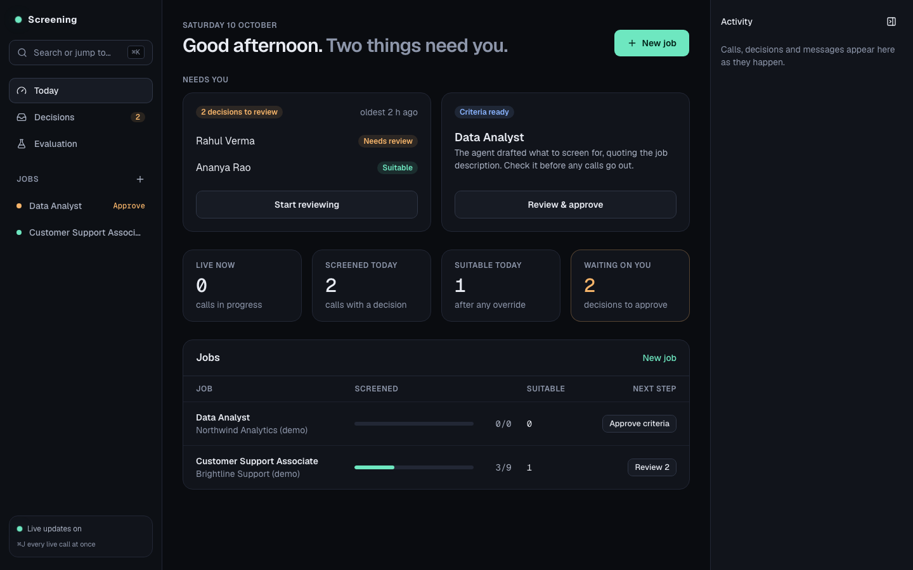
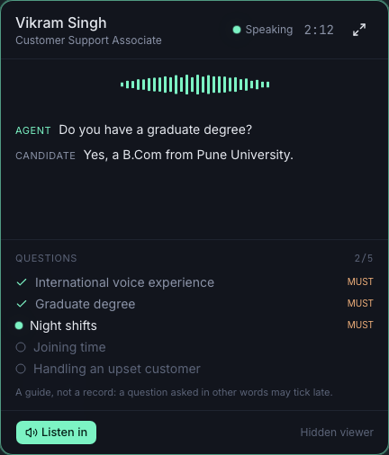

# voiceAgent-web

[](https://www.youtube.com/watch?v=UO8bbi6Go_w)

**Demo (5 min):** [a real call to my phone, from job description to decision and email](https://www.youtube.com/watch?v=UO8bbi6Go_w). 90-second version: [youtu.be/Z1k4k22qc9c](https://youtu.be/Z1k4k22qc9c).

The recruiter's screen for [voiceAgent](https://github.com/mohammed-usmani/voiceAgent), an AI phone-screening backend: a job
description becomes screening criteria, an agent phones candidates, every call ends in a decision a
recruiter reviews, and an evaluation suite measures each stage.

- **Today**: what needs the recruiter now (a live call, decisions to review, criteria to approve), today's numbers, and each job's next step; the activity feed sits alongside.
- **New job**: the criteria agent drafts, critiques and revises live; each requirement shows where in
  the description it came from, and lines it dropped (e.g. illegal criteria) are struck through.
- **Job workspace**: criteria (edit, approve), candidates (add, import CSV, call, stop calling,
  delete), campaign (calling hours on a clock in the job's time zone, a board of every stage),
  decisions.
- **Live calls**: when a candidate answers, a panel pops up with word-by-word captions, the agent's
  state, the questions ticking off and turn-taking timings; other calls wait in a dock, and ⌘J opens
  a wall of all of them. "Listen in" plays the audio.
- **Decision review**: evidence requirement by requirement, the reviewer agent's view, the drafted
  email, approve & send, or override (which calibrates future scoring).
- **Evaluation**: every run of `screening-eval`, stage by stage, expected vs actual, each simulated
  candidate's transcript, run comparison and the known limits.





## How it fits together

```
Browser ──► Next.js route handlers (adds the API key) ──► voiceAgent API (FastAPI)
   │            also proxies the event stream
   └──► LiveKit — a hidden, listen-only viewer of each live call (token from the API)
```

The browser never sees the API key. Server data lives in TanStack Query and is refreshed by the
backend's event stream; live-call data (captions, agent state, progress) comes straight from LiveKit.

## Run it

You need Node 22.18 or newer and a running voiceAgent backend (Postgres, API, worker and call
agent — see its README).

```bash
# in ../voiceAgent
uv run screening-api            # the REST API (SCREENING_API_KEY in its .env)
uv run screening-worker         # criteria, campaigns, assessments, emails
uv run voiceagent dev           # the call agent
uv run screening-demo-seed      # optional: a demo workspace (2 jobs, 12 candidates)

# here
cp .env.example .env.local      # set SCREENING_API_URL and SCREENING_API_KEY
npm ci
npm run dev                     # http://localhost:3000
```

Shortcuts: ⌘K jump anywhere · ⌘J live wall · ⌘. activity rail · Esc closes.

## Tests

```bash
npm run check   # TypeScript, ESLint, unit tests (Vitest)
npm run e2e     # Playwright against a fake backend and fake LiveKit events, plus screenshots
```

The fake backend (`e2e/mock/server.ts`) serves the same routes in memory, so the proxy and the event
stream are exercised too. `npm run e2e -- --update-snapshots` refreshes the screenshots after an
intended visual change.

## Recording the demo

A 3–4 minute walkthrough for a screen recording, with a real phone. Rehearse once.

**Before recording**

1. Backend up (API, worker, agent) and `uv run screening-demo-seed` run on a fresh database.
2. Add yourself as a candidate on the seeded support job, with the phone (or SIP softphone) you'll
   answer. Keep the phone on loud, notifications off on the computer.
3. Browser window 1440×900, zoom 100%, activity rail open, no other tabs. Check the sidebar badge
   says **Live**.
4. Have the job description ready to paste (e.g. `voiceAgent/evals/jobs/customer-support`).

**Scenes**

1. **Overview (15 s).** Pan across today's numbers, the jobs and their campaigns, the outcomes chart.
2. **The criteria agent (45 s).** New job → paste the description, title, company → *Generate
   criteria*. Let the timeline fill in: retrieve, draft, critique, revise, finalize. Hover two
   requirement cards to show their source highlighted in the description; point at a dropped line
   and its reason. Move the pass mark, then *Approve criteria*.
3. **Calling (20 s).** Open the seeded job → Candidates. Show the table and *Stop calling* on one
   candidate. Then *Call now* on yourself (or start the campaign on the Campaign tab and show the
   calling-hours clock and the board).
4. **The live call (60–90 s).** Answer the phone. The panel pops up: click *Listen in*. Answer the
   questions naturally; the checklist ticks, the glow follows the agent speaking and thinking, the
   turn timeline fills in. Open the live wall with ⌘J for a second, close it. Hang up when the agent
   closes the call: "Completed · assessing…" flips to the verdict.
5. **Decision review (40 s).** *Review decision*: walk the requirement rows (quote, rule,
   confidence), the reviewer's view, the drafted email. Either *Approve & send*, or *Override* with a
   note and point at "this calibrates future scoring".
6. **Evaluation (30 s).** The run timeline, a stage card or two, the expected-vs-actual matrix, one
   persona's transcript, then *Known limits*.

**Two calls at once (optional).** Seed a second candidate with another phone; answer both. The
first keeps the focus, the second docks with a toast; click it in the dock to switch.

**If something goes wrong on camera**: a "Reconnecting…" badge recovers by itself; "Live view
unavailable" means the call is still running and the transcript appears after it; a full-page
"Can't reach the screening backend" means the API stopped — restart it and press *Retry*.
